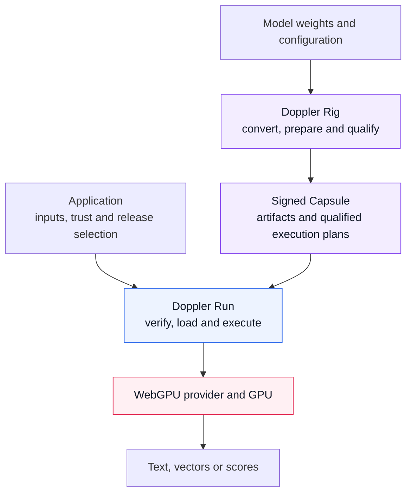
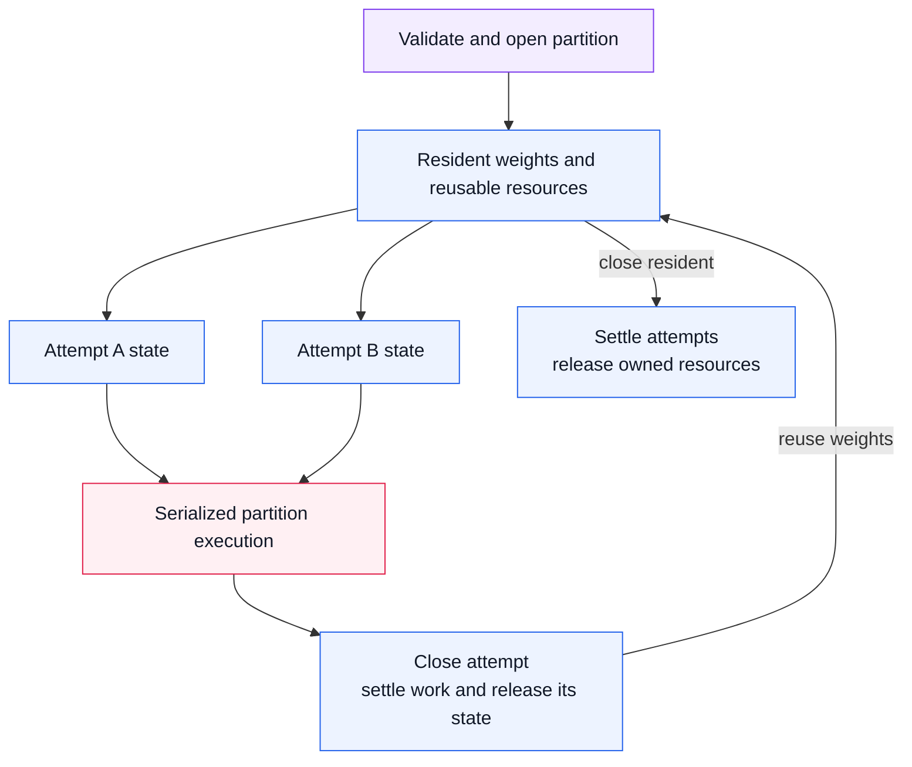

# Doppler

A JavaScript library for local model execution through WebGPU: generation,
embeddings, reranking, and choice scoring, qualified per model and host.

**[Try the demo](https://d4da.com/doppler/)** · [Get started](docs/getting-started.md) · [Documentation](docs/INDEX.md)

## Get started

Run the pinned published quickstart with Node 20+ and a working WebGPU provider:

```sh
npx --package doppler-gpu@0.6.1 doppler-gpu --model gemma3-270m --prompt "Describe WebGPU briefly"
```

First execution downloads model assets. Browser and Node support are qualified
separately. The [installation guide](docs/getting-started.md) covers provider
requirements and embedding the published compatibility API.

The checkout's [signed Run API](docs/api/root.md) and resident partition exports
have separate release requirements; do not assume they exist in npm 0.6.1.

## Technical architecture

### Preparation, host, and execution ownership

Rig prepares the implementation; Run executes its declared computation.
Applications choose trusted publishers, accepted releases, and user-facing policy.



JSON declares execution, JavaScript manages resources and dispatch, and WGSL
performs tensor computation. Doe is an optional provider; Reploid is an optional
consumer. Neither is required to adopt Doppler.

### Resident partitions and resource lifetime

The [two-partition interface](docs/distribution/resident-partition-execution.md)
separates retained weights from each attempt's mutable generation state.



Live continuation requires live state; it is not a portable checkpoint.
Manifest-based opening and signed-Capsule opening have distinct qualification.

## Evidence

<!-- model-type-clusters:start -->

**Model catalog:** text generators, multimodal generators, diffusion language models, translation specialists, language embedders, rerankers, protein encoders, nucleotide encoders.
The [support matrix](docs/model-support-matrix.md) separates catalog entries
from verified execution and links the lifecycle evidence for each model.

<!-- model-type-clusters:end -->

The [comparison scoreboard](docs/model-competition-scoreboard.md) reports
throughput and loading separately against declared controls. Runtime correctness,
task quality, memory, and lifecycle acceptance remain separate checks.
W8A8 remains experimental; it does not qualify distributed chat.

Choice scores are uncalibrated. Unsupported paths fail closed. The retained
[search starter](examples/document-search/README.md) needs renewed signed
eligibility before fresh-install use; see [installation limits](docs/getting-started.md#retained-search-starter).

## Read next

- [API index](docs/api/index.md) — operations and public entrypoints.
- [Architecture](docs/architecture.md) — preparation and execution boundaries.
- [Goals](GOALS.md) · [Contributing](docs/contributing.md) — priorities and development.

## License

[MIT](LICENSE). See [NOTICE](NOTICE) for attribution.
