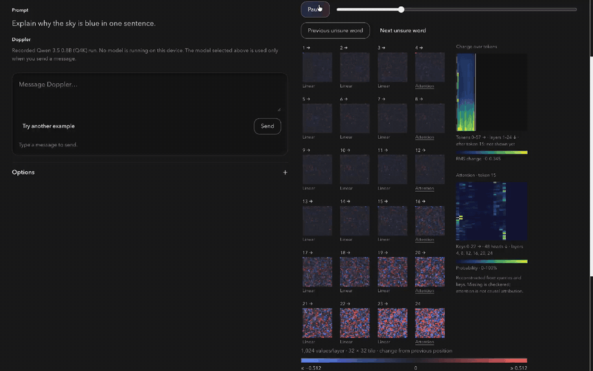
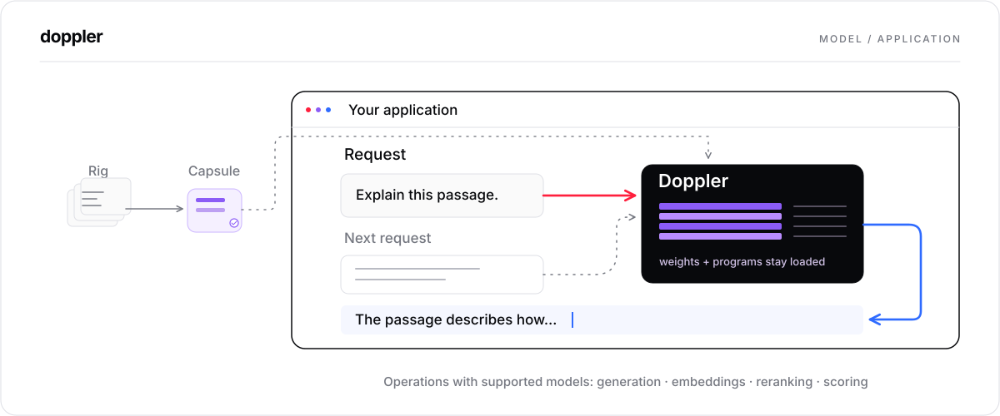
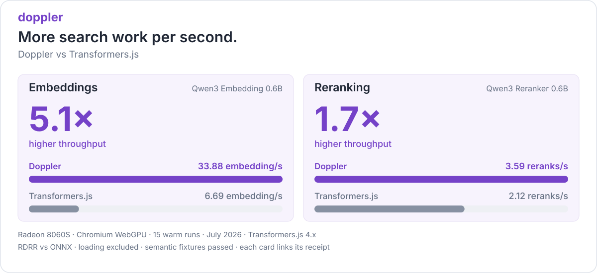
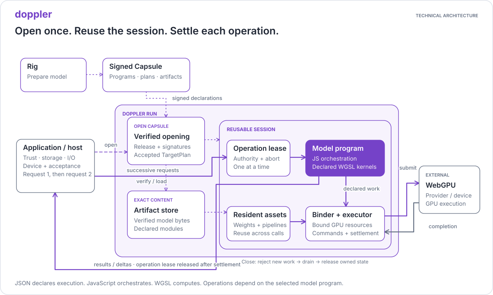

# Doppler

Run open models locally with WebGPU from JavaScript. Doppler generates text, computes embeddings, reranks results, and scores choices on supported models and devices.

**[Try the token demo](https://d4da.com/doppler/demo/index.html)** · [Open Observatory](https://d4da.com/observatory/) · [Run locally](#get-started)

<a href="assets/readme/doppler-demo-hero.mp4"></a>

The demo opens with a recorded answer. Select a token to inspect its alternatives, or load a compatible model to generate on your device. [Watch the full-quality recording](assets/readme/doppler-demo-hero.mp4)

<picture>
  <source media="(max-width: 640px)" srcset="assets/readme/application-mobile.svg" />
  
</picture>

## Get started

Use Node 20+ and a working WebGPU provider. This command pins the published CLI and model alias used in the installation guide.

```sh
npx --package doppler-gpu@0.7.0 doppler-gpu --model gemma3-270m --prompt "Describe WebGPU briefly"
```

The first run downloads about 400 MB of weights plus the tokenizer and manifest. See [installation and embedding](docs/getting-started.md) for host requirements.

[Published versions](https://www.npmjs.com/package/doppler-gpu) · [Source changelog](CHANGELOG.md) · [Signed Run API](docs/api/root.md)

## Benchmarks

<picture>
  <source media="(max-width: 640px)" srcset="assets/readme/retrieval-benchmarks-mobile.svg" />
  
</picture>

[Setup and receipts](docs/model-competition-scoreboard.md)

## Technical architecture

### Preparation, host, and execution ownership



Rig prepares a signed Capsule and its execution plans. Run verifies the artifacts and selects a plan. A session reuses the loaded weights and GPU programs across requests. The application supplies trust and host access.

[Architecture and source owners](docs/architecture.md) · [Resident partition lifetimes](docs/architecture.md#resident-partitions-and-resource-lifetime)

## Evidence

<!-- model-type-clusters:start -->

**Model catalog:** text generators, multimodal generators, diffusion language models, translation specialists, language embedders, rerankers, protein encoders, nucleotide encoders.
The [support matrix](docs/model-support-matrix.md) separates catalog entries
from verified execution and links the lifecycle evidence for each model.

<!-- model-type-clusters:end -->

The [comparison scoreboard](docs/model-competition-scoreboard.md) reports
throughput and loading separately against declared controls. Runtime correctness,
task quality, memory, and lifecycle acceptance remain separate checks.
W8A8 remains experimental.

Choice scores are uncalibrated. Unsupported paths fail closed. The retained
[search starter](examples/document-search/README.md) needs renewed signed
eligibility before fresh-install use; see [installation limits](docs/getting-started.md#retained-search-starter).

## Read next

- [API index](docs/api/index.md) — operations and public entrypoints.
- [Architecture](docs/architecture.md) — preparation and execution boundaries.
- [Goals](GOALS.md) · [Contributing](docs/contributing.md) — priorities and development.

## License

[MIT](LICENSE). See [NOTICE](NOTICE) for attribution.
