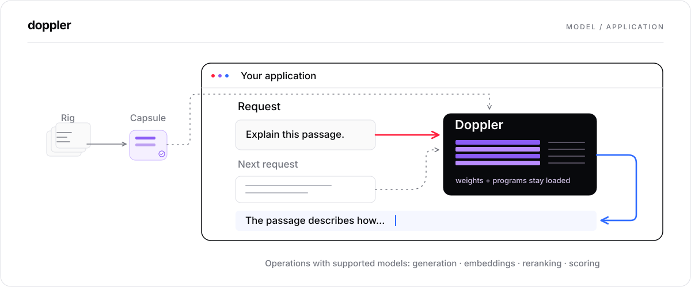
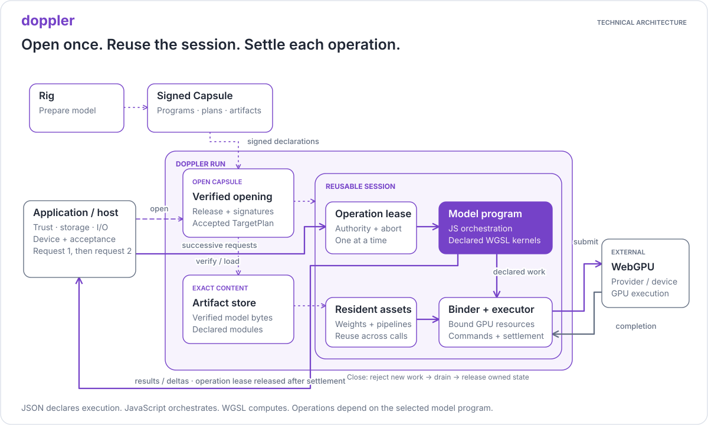

# Doppler

A JavaScript library for local model execution through WebGPU: generation,
embeddings, reranking, and choice scoring, qualified per model and host.

**[Try the demo](https://d4da.com/doppler/)** · [Get started](docs/getting-started.md) · [Documentation](docs/INDEX.md)

<picture>
  <source media="(max-width: 640px)" srcset="assets/readme/application-mobile.svg" />
  
</picture>

## Get started

Run the pinned published quickstart with Node 20+ and a working WebGPU provider:

```sh
npx --package doppler-gpu@0.6.1 doppler-gpu --model gemma3-270m --prompt "Describe WebGPU briefly"
```

First execution downloads model assets. Browser and Node support are qualified
separately. The [installation guide](docs/getting-started.md) covers provider
requirements and embedding the published compatibility API.

The checkout's [signed Run API](docs/api/root.md) and resident partition exports
have separate release requirements; do not assume they exist in npm 0.6.1.

## Technical architecture

### Preparation, host, and execution ownership



Rig prepares signed Capsules with declared TargetPlans. Run verifies artifacts
and selects an accepted plan; session operations reuse resident resources through
the model program, binder, and command executor. Applications supply trust and
host ports. JSON declares execution, JavaScript orchestrates, and WGSL computes.
Doe and Reploid remain optional integrations.

[Architecture and source owners](docs/architecture.md) · [Resident partition lifetimes](docs/architecture.md#resident-partitions-and-resource-lifetime)

## Evidence

### Measured comparisons

The [scoreboard](docs/model-competition-scoreboard.md) retains browser generation,
embedding and reranking measurements with diagrams and linked receipts.
The July Qwen results used Transformers.js 4.0.1 and the original ONNX exports.
Their large warm-generation ratios do **not** establish an advantage over the
optimized replacements now identified by the upstream model cards.

New Qwen comparisons select the `-ONNX-OPT` exports. Their performance and output
parity remain unmeasured here; the [baseline audit](benchmarks/vendors/README.md#qwen-baseline-audit-2026-10-15)
records the correction and required comparison. Historical receipts remain intact.

**JavaScript orchestration. WGSL compute. No mandatory ONNX Runtime dependency.**
This checkout declares zero mandatory npm runtime dependencies; model assets and
the host's WebGPU provider are separate. Rig prepares model programs; Run executes
them and reuses resident resources across requests. See the
[source ownership map](docs/architecture.md). This is an architecture/dependency
statement, not a measured browser-bundle-size or lines-of-code comparison.

<!-- model-type-clusters:start -->

**Model catalog:** text generators, multimodal generators, diffusion language models, translation specialists, language embedders, rerankers, protein encoders, nucleotide encoders.
The [support matrix](docs/model-support-matrix.md) separates catalog entries
from verified execution and links the lifecycle evidence for each model.

<!-- model-type-clusters:end -->

The [comparison scoreboard](docs/model-competition-scoreboard.md) reports
throughput and loading separately against declared controls. Runtime correctness,
task quality, memory, and lifecycle acceptance remain separate checks.
W8A8 remains experimental; it does not qualify distributed chat.

Choice scores are uncalibrated. Unsupported paths fail closed. The retained
[search starter](examples/document-search/README.md) needs renewed signed
eligibility before fresh-install use; see [installation limits](docs/getting-started.md#retained-search-starter).

## Read next

- [API index](docs/api/index.md) — operations and public entrypoints.
- [Architecture](docs/architecture.md) — preparation and execution boundaries.
- [Goals](GOALS.md) · [Contributing](docs/contributing.md) — priorities and development.

## License

[MIT](LICENSE). See [NOTICE](NOTICE) for attribution.
