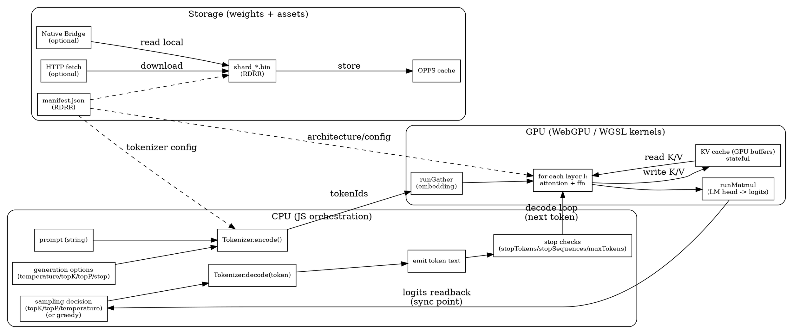

# Inference Module

Purpose: End-to-end inference pipeline orchestration and helpers.

Boundary note:
- Contract boundaries are canonical in `docs/pipeline-contract.md`.
- This file is implementation-level reference for inference internals.

## Scope

- Pipeline orchestration, tokenization, KV cache, MoE routing, sampling.
- Modular pipeline helpers and refactor checklist context.

This directory contains DOPPLER's inference pipeline and its main building blocks:

- `pipelines/text.js`: end-to-end text orchestration (prefill, decode loop, sampling, debug)
- `pipelines/diffusion/`: image diffusion pipeline modules
- `pipelines/energy/`: energy-model pipeline modules
- `tokenizer.js` and `tokenizers/`: tokenizer backends and manifest-driven selection
- `kv-cache/`: KV cache layouts and policies (base, sliding-window, tiered, quantized, paged)
- `moe-router.js`: MoE routing and expert execution planning
- `speculative.js`: speculative decoding scaffolding
- `pipelines/text/`: modular text helpers
  - `config.js`, `init.js`, `state.js`
  - `generator/generator.js` (generation loop), `generator/generator-steps.js`,
    `generator/prefill/`, `generator/decode/`, `generator/sampling/`
  - `embedding/embed.js`, `execution/layer.js`, `logits/`, `attention/`, `ffn/`, `moe/`

## Related
- [Pipeline Steps (Overview)](#pipeline-steps-overview) below for the module that owns each step
- `docs/architecture.md` for system terminology and runtime dataflow context
- `gpu/kernel-selector.js` for the WGSL wrapper API (`run*` and `record*`)

---

## The Full Inference Graph (Conceptual)

This is the high-level execution graph for text generation. It is a dataflow graph with state (KV cache) plus a decode loop.



CPU and GPU boundary notes:

- `device.queue.submit()` schedules GPU work and returns immediately.
- `readBuffer(...)` for logits (or any GPU readback) creates a synchronization point.
- The KV cache is GPU-resident state that persists across decode steps.

---

## One Transformer Layer Graph (Kernel Names)

The per-layer graph below uses the kernel wrapper names from `gpu/kernel-selector.js`. The actual WGSL variant selected depends on device features (`shader-f16`, `subgroups`) and runtime choices (attention tier, batching).

```dot
digraph DopplerLayer {
  rankdir=LR;
  node [shape=box, fontsize=10];

  x_in [label="hidden states X\n(GPUBuffer)"];

  norm1 [label="runRMSNorm"];
  q [label="runMatmul (Q)"];
  k [label="runMatmul (K)"];
  v [label="runMatmul (V)"];
  qnorm [label="runRMSNorm (Q)\n(optional)"];
  knorm [label="runRMSNorm (K)\n(optional)"];
  rope_q [label="runRoPE (Q)"];
  rope_k [label="runRoPE (K)"];
  kv_write [label="KV cache update\n(+ castF32ToF16 if enabled)"];
  attn [label="runAttention\n(tiled_large/tiled_small/streaming,\n_prefill or _decode variant)"];
  o [label="runMatmul (O)"];
  res1 [label="runResidualAdd"];

  norm2 [label="runRMSNorm\n(model-dependent)"];

  ffn_dense [label="Dense FFN path:\nrunMatmul -> runSiLU/runGeLU\n(or runSwiGLURowsplitBias)\n-> runMatmul"];
  ffn_moe [label="MoE FFN path:\ncomputeRouterLogitsGPU (uses runMatmul)\n-> runSoftmaxTopK\n-> runMoEGather\n-> expert matmuls (+ dequantizeMXFP4Expert)\n-> runScatterAddDynamic"];

  res2 [label="runResidualAdd"];
  x_out [label="hidden states X'\n(GPUBuffer)"];

  x_in -> norm1 -> q;
  norm1 -> k;
  norm1 -> v;

  q -> qnorm [style=dashed, label="if qkNorm"];
  k -> knorm [style=dashed, label="if qkNorm"];
  qnorm -> rope_q;
  knorm -> rope_k;
  q -> rope_q [style=dashed, label="else"];
  k -> rope_k [style=dashed, label="else"];

  rope_k -> kv_write;
  v -> kv_write;

  rope_q -> attn;
  kv_write -> attn;

  attn -> o -> res1;
  x_in -> res1 [style=dashed, label="skip"];

  res1 -> norm2;
  norm2 -> ffn_dense;
  norm2 -> ffn_moe;

  ffn_dense -> res2;
  ffn_moe -> res2;
  res1 -> res2 [style=dashed, label="skip"];

  res2 -> x_out;
}
```



Notes:

- Prefill and decode share the same graph, but use different attention behavior:
  - Prefill writes many KV entries and can use a different attention kernel path.
  - Decode appends one KV entry per step and reads the full cache for attention.
- Many kernels have both `run*` and `record*` forms:
  - `run*` submits immediately
  - `record*` records into a shared command buffer for batching

---

## Where WGSL Lives

WGSL kernels are in `gpu/kernels/`. The wrappers in `gpu/kernel-selector.js` compile and dispatch them, selecting variants based on device capabilities and the operation's dtype.

---

## Pipeline Steps (Overview)

The order below is the text path. Each step names the module that owns it;
the [inference pipeline section](../../docs/architecture.md#2-inference-pipeline-inference)
of the architecture guide has the detailed dataflow.

1. **Device**: `initDevice()` and `getKernelCapabilities()` in
   `src/gpu/device.js` (adapter, `shader-f16`, `subgroups`, limits).
2. **Manifest and config**: the RDRR manifest is parsed by
   `src/formats/rdrr/`; model parameters come from the manifest through
   `parseModelConfigFromManifest()` in `pipelines/text/config.js`. There is no
   runtime model-family detection.
3. **Weights**: `src/loader/doppler-loader.js` loads embeddings, layers and
   final weights (`embedding-loader.js`, `layer-loader.js`,
   `final-weights-loader.js`) through the pipeline's storage context.
4. **KV cache**: `kv-cache/` (base, sliding-window, tiered, quantized and
   paged layouts).
5. **Tokenizer**: `tokenizer.js` with backends in `tokenizers/`.
6. **Prefill**: `pipelines/text/generator/prefill/` runs every prompt token
   through the per-layer path in `pipelines/text/execution/layer.js`
   (`attention/`, `ffn/`, `moe/`), writing K/V into the cache.
7. **Logits**: `pipelines/text/logits/` projects the final hidden state and
   reads back what sampling needs.
8. **Sampling**: `pipelines/text/generator/sampling/` (temperature, top-k,
   top-p, stop checks); `token-sampling.js` owns the seeded per-token draw.
9. **Decode loop**: `pipelines/text/generator/decode/` appends one token per
   step until a stop condition or `maxTokens`; the loop is driven by
   `pipelines/text/generator/generator.js`.

---

## Key Architecture Differences

### Sandwich Norm (Gemma 3) vs Standard (LLaMA/Mistral)

```
┌─────────────────────────────────────────────────────────────────────┐
│ STANDARD (LLaMA, Mistral, Mixtral)                                  │
├─────────────────────────────────────────────────────────────────────┤
│ x = x + attn(input_norm(x))           ← residual wraps attention    │
│ x = x + ffn(post_attn_norm(x))        ← residual wraps FFN          │
└─────────────────────────────────────────────────────────────────────┘

┌─────────────────────────────────────────────────────────────────────┐
│ SANDWICH (Gemma 3)                                                  │
├─────────────────────────────────────────────────────────────────────┤
│ h = attn(input_norm(x))                                             │
│ h = post_attention_norm(h)            ← norm ON attention output    │
│ x = x + h                             ← then residual add           │
│ h = ffn(pre_feedforward_norm(x))                                    │
│ h = post_feedforward_norm(h)          ← norm ON FFN output          │
│ x = x + h                             ← then residual add           │
└─────────────────────────────────────────────────────────────────────┘
```

---

## Files Reference

See the [architecture file map](../../docs/architecture.md#key-files) and
[pipeline submodules](../../docs/architecture.md#pipeline-submodules-inferencepipelines)
for maintained source entrypoints.

<!-- DOPPLER_KERNEL_OVERRIDES -->
## Kernel Overrides & Compatibility
See [Kernel Compatibility and Overrides](../../docs/style/wgsl-style-guide.md#kernel-compatibility-and-overrides) (canonical section).
